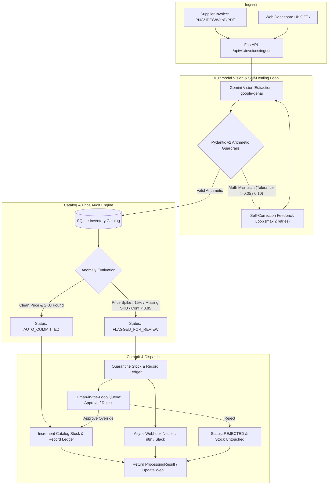

# StockOps Autonomous Inventory & Supply Chain Agent

[](https://www.python.org/)
[](https://fastapi.tiangolo.com/)
[](https://docs.pydantic.dev/)
[](https://github.com/google-gemini/deprecations)
[](https://www.docker.com/)
[](https://pytest.org/)

**StockOps AI Agent** is an enterprise-grade autonomous inventory intelligence and invoice verification system. It ingests supplier invoices in multiple multimodal formats (PNG, JPEG, WebP, PDF), extracts structured line items via Google Gemini (`google-genai`), enforces deterministic arithmetic guardrails via Pydantic v2 with an automated LLM self-correction loop, audits unit costs against historical SQLite baselines, auto-commits verified stock to an immutable ledger, and quenches price drift by dispatching asynchronous webhook alerts (n8n/Slack) for price spikes, unrecognized SKUs, or low-confidence scans.

Includes a **Live Operations Web Dashboard UI** served directly from FastAPI at `http://localhost:8000/` featuring live KPI telemetry, drag-and-drop document inspection, an instant 1-click scenario simulator, and an interactive **Human-in-the-Loop (HITL)** quarantine queue for manual review approvals or rejections.

---

## Live Ops Web Dashboard & HITL Queue

Launch the entire stack with a single command (`uvicorn app.main:app --reload --port 8000`) and access the interactive industrial dark-mode dashboard at:
👉 **`http://localhost:8000/`**

- **Zero-Node Architecture**: Served natively by FastAPI without requiring separate Node.js or npm build tooling.
- **Real-Time Telemetry Ribbon**: Live calculations of total catalog valuation, active SKU count, physical warehouse units, auto-committed counts, and quarantined items.
- **Multimodal Drag & Drop Inspector**: Drop invoice images or PDFs to watch live Gemini vision extraction, confidence scoring, and Pydantic v2 math verification badges.
- **1-Click Instant Simulator**: Test clean invoices, $+28.5\%$ price spikes, and unmapped SKU quarantines instantly—even before configuring a live `GEMINI_API_KEY`.
- **Human-in-the-Loop (HITL) Queue**: Interactively review flagged invoices directly from the table with 1-click **Approve** (increments stock and marks ledger as `APPROVED_OVERRIDE`) or **Reject** (preserves stock and marks ledger as `REJECTED`).

---

## Architecture Pipeline



---

## Key Features

- **Multimodal Document Processing (`google-genai` SDK)**: Ingests raw binary invoices and leverages the official Google GenAI SDK for zero-data-loss document parsing.
- **Deterministic Math Guardrails**: Zero tolerance for LLM arithmetic hallucinations. Pydantic v2 `@model_validator(mode="after")` validates:
  - $\text{Line Total} = \text{Quantity} \times \text{Unit Price}$ (tolerance $\le \$0.05$)
  - $\text{Subtotal} = \sum \text{Line Totals}$ (tolerance $\le \$0.10$)
  - $\text{Total Amount} = \text{Subtotal} + \text{Tax}$ (tolerance $\le \$0.10$)
- **Autonomous Self-Healing Loop**: If Gemini generates an arithmetic inconsistency, the agent catches the Pydantic `ValidationError`, constructs a targeted error traceback prompt, and feeds it back into the model to self-correct within up to 2 retries.
- **Historical Price Drift Protection**: Detects unannounced supplier price surges ($> 15.0\%$) and unknown SKUs by comparing against an SQLite baseline catalog.
- **Auditable Stock Ledger & HITL**: Automatically increments inventory only when 100% verified; quarantines suspicious items in an immutable audit ledger until resolved by a human operator.
- **Resilient Webhook Dispatcher**: Non-blocking asynchronous `httpx` dispatcher compatible with n8n, Zapier, and Slack incoming webhooks.
- **100% Offline Testability & Demo Fallback**: Complete test isolation with mocked LLM clients, zero external API key requirements for CI/CD test runs, and smart fallback demo modes for offline local testing.

---

## Evaluation Benchmark Scorecard

Deterministic evaluation executed via `python evals/run_benchmark.py`:

| Scenario | Test Case Description | Expected Action | Actual Outcome | Guardrail Enforced | Status |
| :--- | :--- | :--- | :--- | :--- | :---: |
| **Scenario 1: Clean Auto-Commit** | Standard invoice matching catalog price ($14.50) | `AUTO_COMMITTED & Stock +10` | `AUTO_COMMITTED (Stock: 130)` | Catalog Price Match (0% diff) | **PASSED** |
| **Scenario 2: Math Self-Correction** | LLM hallucinated line total (5*19.20=120 vs 96.00) | `Self-Correct via Retry (Attempt 2)` | `Recovered line_total=$96.00` | Pydantic v2 @model_validator | **PASSED** |
| **Scenario 3: Price Spike Detection** | FL-COB-100W billed at $36.00 vs $28.00 (+28.57%) | `FLAGGED_FOR_REVIEW & Zero Stock Drift` | `Flagged +28.57% (Stock preserved)` | Price Spike Threshold (>15.0%) | **PASSED** |
| **Scenario 4: SKU Integrity Gate** | Unknown SKU not present in catalog | `FLAGGED_FOR_REVIEW & Quarantined` | `FLAGGED_FOR_REVIEW (UNKNOWN-TRANS-800VA unrecognized)` | Foreign Key Catalog Verification | **PASSED** |
| **Scenario 5: Vision Confidence Gate** | Low scan quality (confidence score 0.74 < 0.85) | `FLAGGED_FOR_REVIEW & Alert Triggered` | `FLAGGED_FOR_REVIEW (confidence 0.74 < 0.85)` | Confidence Floor (>=0.85) | **PASSED** |

**Benchmark Reliability:** **5/5 Passed (100.0%)**

---

## Repository Structure

```text
stockops-ai-agent/
├── app/
│   ├── __init__.py
│   ├── main.py                  # FastAPI application, UI mount, simulation & HITL endpoints
│   ├── schemas.py               # Pydantic v2 schemas & arithmetic math validators
│   ├── agent.py                 # Gemini multimodal extraction & self-healing retry loop
│   ├── database.py              # SQLite inventory catalog, ledger & HITL approval operations
│   ├── notifier.py              # Async httpx webhook dispatcher (n8n/Slack)
│   └── static/
│       ├── index.html           # Dark-Mode Live Ops Web Dashboard (Tailwind CSS + Lucide Icons)
│       └── app.js               # Async state manager, drag-and-drop uploader & HITL controls
├── scripts/
│   └── generate_samples.py      # Pillow script to render synthetic test invoices
├── sample_data/
│   ├── valid_invoice.png        # Clean test invoice matching catalog baseline
│   └── anomaly_invoice.png      # Quarantined test invoice with +28.57% unit price spike
├── evals/
│   ├── __init__.py
│   ├── test_schemas.py          # Math guardrail unit tests
│   ├── test_pipeline.py         # End-to-end FastAPI, SQLite, and Mocked LLM tests
│   ├── test_ui_and_hitl.py      # UI delivery, KPI metrics, and HITL lifecycle tests
│   └── run_benchmark.py         # CLI evaluation scorecard table generator
├── data/                        # Persistent SQLite database storage
├── .github/
│   └── workflows/ci.yml         # GitHub Actions automated test & benchmark pipeline
├── pyproject.toml               # Pinned pytest configuration silencing loop-scope warnings
├── .env.example                 # Configurable environment templates
├── .gitignore                   # Ignore runtime artifacts & credentials
├── Dockerfile                   # Production Python 3.12-slim container
├── docker-compose.yml           # Unified orchestration with n8n webhook receiver
├── requirements.txt             # Pinned dependencies
└── README.md                    # Documentation & operational handbook
```

---

## Quickstart Guide

### Option 1: Docker Compose (Recommended)

Run the full system along with an n8n webhook receiver in a single command:

```bash
# 1. Clone repository and create local environment file
cp .env.example .env

# 2. Add your Gemini API key to .env (or leave blank to use the smart demo simulator)
# GEMINI_API_KEY=AIzaSy...

# 3. Spin up StockOps Agent and n8n webhook listener
docker compose up --build
```

- **Live Ops Web Dashboard**: `http://localhost:8000/`
- **Interactive Swagger Docs**: `http://localhost:8000/docs`
- **n8n Automation Console**: `http://localhost:5678`

---

### Option 2: Local Python Setup

```bash
# 1. Create and activate a Python 3.11/3.12 virtual environment
python -m venv .venv
source .venv/bin/activate  # On Windows: .venv\Scripts\activate

# 2. Install dependencies
pip install -r requirements.txt

# 3. Generate synthetic sample invoices
python scripts/generate_samples.py

# 4. Run the full test suite (36 tests)
pytest -v

# 5. Start the FastAPI development server & Web UI
uvicorn app.main:app --reload --host 0.0.0.0 --port 8000
```

Open `http://localhost:8000/` in your browser.

---

## API Endpoints

| Method | Endpoint | Description |
| :--- | :--- | :--- |
| `GET` | `/` | Interactive Live Operations Web Dashboard UI |
| `GET` | `/health` | Application health and status verification |
| `GET` | `/api/v1/metrics` | Retrieve live warehouse valuation and ledger status KPIs |
| `GET` | `/api/v1/inventory` | Retrieve current stock count and average unit costs |
| `GET` | `/api/v1/ledger` | Query immutable audit log of all ingested invoices |
| `POST` | `/api/v1/invoices/ingest` | Ingest and audit supplier invoice (PNG/JPEG/WebP/PDF) |
| `POST` | `/api/v1/invoices/simulate/{scenario}` | 1-Click simulator (`valid`, `anomaly`, `unrecognized_sku`) |
| `POST` | `/api/v1/ledger/{id}/approve` | Human-in-the-Loop override approval (increments stock) |
| `POST` | `/api/v1/ledger/{id}/reject` | Human-in-the-Loop rejection (preserves stock) |

---

## Sample Testing with `curl`

### 1. Ingest Clean Invoice (Auto-Commit)

```bash
curl -X POST "http://localhost:8000/api/v1/invoices/ingest" \
  -H "accept: application/json" \
  -H "Content-Type: multipart/form-data" \
  -F "file=@sample_data/valid_invoice.png;type=image/png"
```

### 2. Ingest Price Anomaly Invoice (Quarantined & Alerted)

```bash
curl -X POST "http://localhost:8000/api/v1/invoices/ingest" \
  -H "accept: application/json" \
  -H "Content-Type: multipart/form-data" \
  -F "file=@sample_data/anomaly_invoice.png;type=image/png"
```

### 3. Human-in-the-Loop Override Approval

```bash
curl -X POST "http://localhost:8000/api/v1/ledger/1/approve"
```

---

## Testing & Quality Assurance

Run the comprehensive offline test suite (36 tests):

```bash
pytest -v
```

Run the benchmark evaluation harness:

```bash
python evals/run_benchmark.py
```

---

## License

MIT License. Built for autonomous supply chain reliability.
